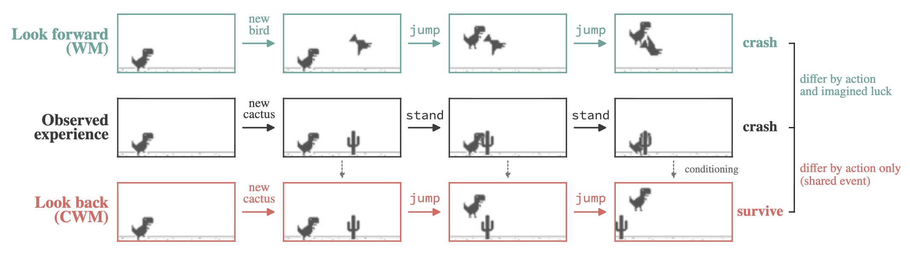
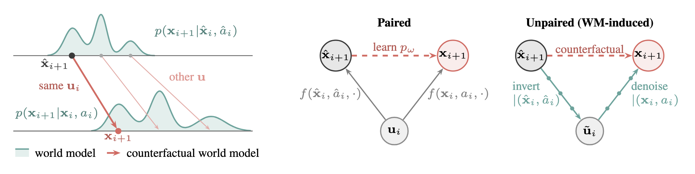
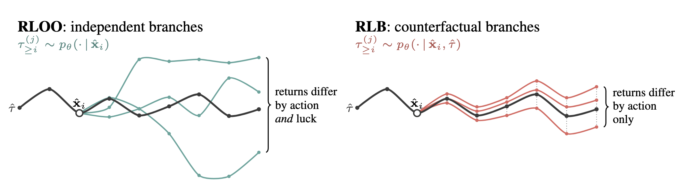

<h1 align="center">Look Back: Reinforcement Learning with<br>Counterfactual World Models</h1>

<div align="center">

**[Jinwoo Kim](https://jw9730.github.io/)**<sup>1\*†</sup>, **[Toghrul Abbasov](https://toghrulabbasov19.github.io/)**<sup>1\*</sup>, **[Lucius E.J. Bynum](https://luciusbynum.com/)**<sup>2</sup>, **[Aahlad Puli](https://aahladmanas.github.io/)**<sup>2</sup>,\
**[Stephanie Milani](https://stephmilani.github.io/)**<sup>2</sup>, **[Hyunwoo Ryu](https://tomato1mule.github.io/)**<sup>3</sup>, **[Seunghoon Hong](https://maga33.github.io/)**<sup>1</sup>,\
**[Kyunghyun Cho](https://kyunghyuncho.me/)**<sup>2‡</sup>, **[Rajesh Ranganath](https://cims.nyu.edu/~rajeshr/)**<sup>2‡</sup>

<sup>1</sup>KAIST &nbsp; <sup>2</sup>NYU &nbsp; <sup>3</sup>MIT

<sup>\*</sup>Equal contribution &nbsp; <sup>‡</sup>Equal advising &nbsp; <sup>†</sup>Work partially done while visiting the Global AI Frontier Lab at NYU

</div>

<div align="center">

[](https://arxiv.org/abs/ADD_ID)

</div>

## TL;DR

<p align="center">
  
</p>

<p align="center">
  
</p>

<p align="center">
  
</p>

We study counterfactual world models (CWMs) and introduce the policy gradient estimator REINFORCE Look Back (RLB), enabling low-variance reinforcement learning in complex, stochastic environments through experience-conditioned counterfactual baselines.

## Overview

**REINFORCE Look Back (RLB)** applies common random numbers to policy gradients by comparing a group of rollouts that start from the same state and share the same environment randomness. Unlike RLOO, which draws fresh randomness for every rollout, the rollouts in an RLB group differ only in the actions taken, so the leave-one-out baseline removes the environment noise from the comparison. This noise is a major source of variance when outcomes depend on randomness the agent cannot see. We extend this to **RLB + CWM**, where a counterfactual world model (CWM) replays the randomness of one real rollout under other actions, so it needs fewer environment interactions.

This repository contains the code for the main experiments in the paper: Chrome Dino with a diffusion world model ([`chrome_dino/`](chrome_dino)), a contextual bandit ([`contextual_bandit/`](contextual_bandit)), and a multi-agent bandit ([`multiagent_bandit/`](multiagent_bandit)). The codebase has been tested with NVIDIA RTX 3090 GPUs.

## Installation

We recommend using the official PyTorch Docker image with CUDA support.

```bash
docker pull pytorch/pytorch:2.3.1-cuda12.1-cudnn8-devel
docker run -it --gpus all --ipc host --name lookback -v /home:/home pytorch/pytorch:2.3.1-cuda12.1-cudnn8-devel bash
```

Assuming the codebase is located at `~/look-back` inside the Docker container,
create the environment and install the required packages:

```bash
cd ~/look-back
conda init bash && source ~/.bashrc
conda create -n lookback python=3.11 -y
conda activate lookback
pip install -r requirements.txt
```

## Chrome Dino

All commands in this section are run from `chrome_dino/`. Each method has its own
training script:

| Method | Script |
|---|---|
| REINFORCE | `scripts/train_policy.sh reinforce` |
| REINFORCE + baseline | `scripts/train_policy.sh reinforce_baseline` |
| RLOO | `scripts/train_policy.sh rloo` |
| RLB | `scripts/train_policy.sh rlb` |
| RLOO + WM | `scripts/train_policy_world_model.sh rloo_wm` |
| RLB + CWM | `scripts/train_policy_world_model.sh rlb_cwm` |

RLOO and RLB share the same leave-one-out loss in `estimators.py`. The difference is that RLB reuses the simulator noise across a group, while RLOO draws new noise for every rollout. The two world model methods simulate one rollout per group and generate the rest with the diffusion model.

### Checkpoints and datasets

Our trained models and datasets are available on [Google Drive](https://drive.google.com/drive/folders/1iSWp6yQBZ7FBg_K1AQOWFFhyr3m_R_Zp?usp=sharing).
Put them in `chrome_dino/checkpoints/` and `chrome_dino/datasets/`:

```text
chrome_dino/checkpoints/       chrome_dino/datasets/
├── base_vae/                  ├── world_model/
├── world_model_step9000/      ├── factual/
├── reward_model.pt            └── factual_ttc.npy
└── policies/
```

`policies/` contains the checkpoint reported in the paper for every method and seed, e.g. `policies/rlb_s1/policy-1700.pth`.

You can also regenerate everything with the scripts below. The settings we used are listed in `configs/experiments.json`.

### Data and reward model

```bash
./scripts/generate_dataset.sh            # world-model training data, 1,000 episodes x 150 decisions
./scripts/generate_factual_dataset.sh    # same settings with another seed, for world-model evaluation
./scripts/build_ttc_cache.sh             # time-to-contact for each factual frame
./scripts/generate_reward_data.sh        # 100 scripted and 100 random episodes
./scripts/train_reward_model.sh          # saves runs/reward_model.pt
```

Outputs go to `datasets/` by default. Paths and the number of workers can be changed through environment variables. `generate_reward_data.sh` collects new episodes from the same distribution.

### Diffusion world model

The world model predicts the next frame from the last eight frames and the action. It uses a frozen VAE, which is expected in `checkpoints/base_vae/` (or set `BASE_VAE`).

```bash
BASE_VAE="$PWD/checkpoints/base_vae" GPU_LIST="0,1,2,3,4,5,6,7" PROCESSES=8 \
./scripts/train_world_model.sh
```

By default it trains for 9,000 steps with batch size 32 and learning rate 2e-4, and saves the model to `runs/world_model_step9000/`. To use a retrained world model or reward model for policy training, copy it to `checkpoints/` or set `WORLD_MODEL` and `REWARD_MODEL`.

### Policy training

All methods are trained for 2,000 updates, each with 32 rollouts (8 groups of 4 for RLOO and RLB). We use discount 0.99, entropy coefficient 0.04 and gradient clipping at 20. Every group starts with the dino standing and an obstacle 8 to 12 frames away, and the starting speeds are balanced over four ranges.

```bash
./scripts/train_policy.sh rlb 1 0                     # method, seed, GPU
./scripts/train_policy_world_model.sh rlb_cwm 1 0

METHODS="rlb rloo rlb_cwm rloo_wm" SEEDS="1 2 3 4 5" GPU_LIST="0 1 2 3" MAX_PARALLEL=4 \
./scripts/run_seed_sweep.sh                           # several methods and seeds at once
```

The paper uses seeds 1 to 15.

### Evaluation

```bash
SEEDS="1 2 3 4 5" ./scripts/evaluate_method.sh rlb
```

We save a checkpoint every 100 updates. For each method, we pick the checkpoint with the lowest mean collision rate over 30 validation episodes per seed, and evaluate it on 100 test episodes per seed. We report the collision rate, the percentage of obstacles that cause a collision (100 minus the pass rate printed by the script), and survival, the mean number of decisions before the first collision.

To test our released policies directly, skip validation by setting `CHECKPOINT` to the checkpoint used in the paper (REINFORCE 2000, REINFORCE + baseline 1900, RLOO 2000, RLB 1700, RLOO + WM 2000, RLB + CWM 1900):

```bash
RESULTS_ROOT="$PWD/checkpoints/policies" CHECKPOINT=1700 ./scripts/evaluate_method.sh rlb
```

To evaluate the world model (composition, effectiveness, realism, minimality and obstacle preservation), you also need the factual dataset, its cache and the [counterfactual benchmark](https://github.com/gulnazaki/counterfactual-benchmark):

```bash
MODEL_FOLDER="$PWD/checkpoints/world_model_step9000" \
DATASET_PATH="$PWD/datasets/factual" TTC_CACHE="$PWD/datasets/factual_ttc.npy" \
BENCHMARK_REPO=/path/to/counterfactual-benchmark \
./scripts/evaluate_world_model.sh
```

## Contextual bandit

In this task, the reward depends on environmental noise that the agent cannot see. Besides the six methods above, we also compare against counterfactual credit assignment (CCA). Commands in the bandit sections are run from the repository root.

```text
c ~ U({-10, ..., 10})              context
a ~ pi_theta(. | c)                action in {-10, ..., 10}
u ~ N(0, sigma^2)                  environmental noise with noise level sigma
x = (c, a + u)                     next state
r = sigma^2 - (c - (a + u))^2      reward, maximized at a = c with E[r] = 0
```

We use noise levels sigma = 0.1, 30 and 60. RLOO and RLB sample m = 4 actions for the same context. RLOO draws new noise u for each action, and RLB uses the same u for all of them. RLOO + WM and RLB + CWM simulate one action and generate the other three with a small Gaussian model, trained on 4,096 pairs of transitions. CCA additionally receives a feedback vector after acting, as in Mesnard et al. (2020). All methods use Adam with learning rate 4e-4, entropy coefficient 4e-3 and a budget of 10M interactions. For the world-model methods, we report two versions: one counts only simulator calls, and the other also counts generated transitions.

```bash
python -m unittest discover -s contextual_bandit/tests -t .
python -m contextual_bandit.run --workers 48     # trains all policies and models
python -m contextual_bandit.summarize            # writes CSVs and prints the results table
python -m contextual_bandit.plot                 # saves the figure to results/contextual_bandit/
```


## Multi-agent bandit

Here K agents share one reward, so most of the reward each agent sees comes from the actions of the other agents. We use K = 8, 20 and 60.

```text
c^i ~ U({-10, ..., 10})            agent i's context, seen only by agent i
a^i ~ pi_theta^i(. | c^i)          agents act independently
r = -sum_i (c^i - a^i)^2           the same reward for every agent
```

For agent i, the contexts and actions of the other agents act as its environmental noise u^i. Each agent gets its own gradient estimate. RLOO and RLB try m = 4 actions for agent i. RLOO redraws u^i for each action, while RLB keeps it fixed. RLOO + WM and RLB + CWM simulate one joint episode, and each agent predicts the outcome of its other actions with its own small model. The training settings are the same as in the contextual bandit.

```bash
python -m unittest discover -s multiagent_bandit/tests -t .
python -m multiagent_bandit.run --workers 64     # trains all policies and models
python -m multiagent_bandit.summarize            # prints the results table
python -m multiagent_bandit.plot                 # saves the figure to results/multiagent_bandit/
```


## Reproducibility

The bandit experiments are deterministic, so rerunning them on the same setup gives the same results. For Dino, policy training and evaluation are seeded and use deterministic GPU kernels. With our world model and reward model, they give the same results on the same software and GPU setup. Training the world model and the reward model is not fully deterministic, so retraining them gives similar models but not identical weights. We therefore recommend using our checkpoints.

## Citation

```bibtex
bibtex here
```

## Acknowledgements

The Dino simulator is adapted from [aome510/chrome-dino-game-rl](https://github.com/aome510/chrome-dino-game-rl), with sprites from [dhhruv/Chrome-Dino-Runner](https://github.com/dhhruv/Chrome-Dino-Runner/tree/master).
The diffusion world model is adapted from [arnaudstiegler/gameNgen-repro](https://github.com/arnaudstiegler/gameNgen-repro).
World-model evaluation uses the [counterfactual benchmark](https://github.com/gulnazaki/counterfactual-benchmark).
We thank the authors for releasing their code.
